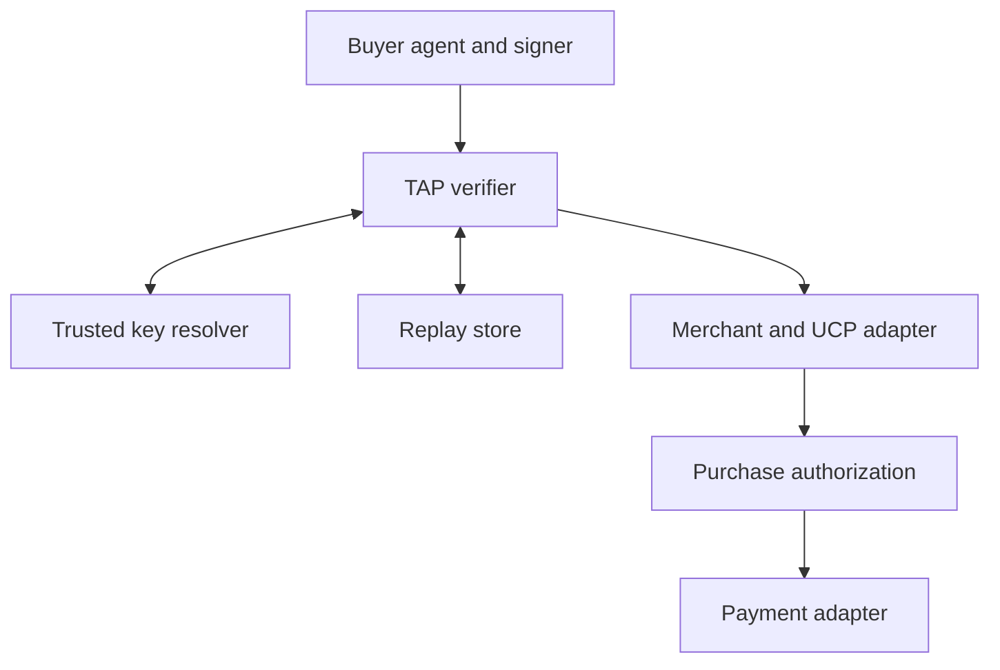

# Arkavo TAP: Rust Specification and Implementation Guide

Version: 0.1 — proposed implementation  
Date: 2026-11-05  
Target: Arkavo Edge and market.arkavo.com  
Status: Design and implementation contract. Phases 1 to 3 of the implementation sequence (profile and fixtures, core library, Rust demo) are implemented in `crates/arkavo-tap`, `crates/arkavo-tap-http` and `crates/arkavo-tap-demo`; see [upstream.md](upstream.md) for what was pinned and tested, and [runbook.md](runbook.md) for how to run it. Later phases remain proposals.

## Purpose and required outcome

Implement Trusted Agent Protocol (TAP) recognition in Rust so an Arkavo agent can identify itself to a merchant while acting on a human's behalf. The merchant must distinguish the acting agent, its provider, the represented human, and the authority granted for a purchase.

The first deliverable is a reproducible local demonstration with separate buyer and merchant identities, request signing, merchant verification, and a simulated order. The next deliverable connects the same verification components to Arkavo Market and the existing UCP commerce implementation.

A successful identity check must never, by itself, authorize a charge.

This document combines the protocol requirements, Rust architecture, development sequence, local runbook, and acceptance tests. It replaces the earlier language-specific sample setup with an API-first implementation. A browser UI is optional.

### Example transaction

A human grants buyer agent A authority to buy one particular offer from merchant M within a USD limit and expiry. Agent A sends a signed request. The merchant verifies the request and identifies A, then separately evaluates the purchase authorization. An unrelated agent B cannot use A's grant. A changed merchant, item, currency, or total fails authorization. Repeating the accepted order does not create a second charge.

## Responsibilities and boundaries

| Component | Responsibility | Evidence it does not provide by itself |
| --- | --- | --- |
| Arkavo agent identity | Identify the runtime actor and its key bindings | Permission to spend a human's funds |
| TAP | Authenticate the request signer under a configured trust authority and convey interaction purpose | Complete purchase authorization or payment settlement |
| UCP / Arkavo commerce adapter | Product, quote, checkout, and order operations | Independent proof of delegated authority |
| AP2 | Verify purchase and payment mandates under the selected AP2 profile | Processor settlement |
| Payment-provider adapter | Submit payments and reconcile provider outcomes | Authority merely because an API call was made |
| SwarmKit delegation | Establish which agent may represent a role or organization | An automatic financial grant |

The existing `arkavo-ucp` module provides payment intents, policy, budget integration, handlers, and MCP tools. Its USD handler records spending; its EVM handler signs offline. Those outcomes must remain distinguishable from a processor-confirmed payment. [S7]

TAP can authenticate an agent provider's key without necessarily identifying an individual runtime instance. Arkavo must preserve that distinction. A runtime ID is verified only when trusted evidence binds it to the signer; an agent-supplied name is a claim.

AP2 integration is a separate implementation dependency. The current AP2 v0.2 model uses Checkout and Payment Mandates. Its supported direct and autonomous flows must be pinned to an upstream revision. Multi-hop payment delegation is outside this initial scope. [S6]

## Standards baseline and compatibility policy

### Upstream baseline

Visa's published TAP material describes an HTTP agent-recognition signature, linked consumer-recognition data, and linked payment data. The recognition signature includes authority/path coverage and timestamp, key, algorithm, nonce, and purpose parameters. Its published validity window is at most eight minutes. Consumer/payment signatures are linked to recognition evidence by key and nonce. Production recognition depends on the configured payment-scheme trust infrastructure. [S1]

HTTP signature parsing and signature-base construction follow RFC 9421. `@path` excludes the query. Header signatures protect only the selected components; content protection requires a covered digest or another appropriately verified binding. `Signature-Input` and `Signature` labels must correspond. Use Structured Fields serialization and preserve the required component/parameter order. Do not construct canonical input with regular expressions or JSON serialization. [S3, S4, S5]

### Three explicit profiles

These are Arkavo configuration names, not new Visa standards.

| Profile | Use | Admission policy |
| --- | --- | --- |
| `arkavo-rfc9421-v1` | Local demo and bilateral Arkavo integration | Strict parsing and the additional request coverage defined below |
| `visa-tap-pinned` | Interoperability with an identified Visa TAP revision | Exact pinned wire rules, trust sources, supported algorithms, and test vectors |
| `visa-sample-fixture` | Testing captured behavior of the public sample | Isolated compatibility tests; never an automatic production fallback |

The public sample is a useful interoperability input, not the security specification. Its documentation and source disagree on some setup details. Its implementation also uses spellings and formatting that need comparison with the standards, including `keyId` versus `keyid` and algorithm identifiers. [S2]

The core must not silently repair invalid signed input. Where an upstream profile needs special handling, isolate it in a named adapter with explicit fixtures and documented limitations. Reject ambiguous input. Never enable a weaker profile because strict verification failed.

### Revision record

Check in a small upstream record containing:

- TAP document retrieval date and retained document hash.
- Public sample commit, if used for fixtures.
- RFC versions and applicable errata.
- AP2 and UCP revisions used by the commerce adapter.
- Accepted algorithm identifiers and key formats for each profile.
- Fixture provenance and known deviations.

A compatibility report must distinguish “Arkavo profile passed,” “published vectors passed,” “independent implementation passed,” and “Visa production onboarding completed.” These are separate results.

## Architecture

Use one reusable verification library, with an HTTP middleware adapter. Deploy that adapter either inside the merchant service or at a trusted ingress; verification logic must not be duplicated.



The authorization component includes AP2 verification when that capability is enabled. TAP verification happens before merchant code treats the caller as an authenticated agent.

### Proposed workspace components

| Component | Responsibility |
| --- | --- |
| `arkavo-tap` | Profile rules, signing, verification, typed evidence, resolver and replay interfaces |
| `arkavo-tap-http` | HTTP/Tower integration and external-request reconstruction |
| `arkavo-tap-demo` | Rust CLI, local registry, merchant fixture, test buyer, test runner |
| Existing `arkavo-ucp` | Commerce state and payment-policy integration |
| AP2 module | Mandate and receipt verification behind an authorization interface |
| Existing identity modules | Runtime identity, secure signing adapters, and role/delegation context |

These can be modules instead of separate crates if that better fits the repository. Keep the cryptographic verifier independent of HTTP framework, model runtime, and payment provider.

### Rust building blocks

Prefer existing workspace dependencies and pin reviewed versions in the lockfile.

| Concern | Candidate implementation |
| --- | --- |
| Async execution | Existing Tokio runtime |
| HTTP service and middleware | Axum/Tower integration or the repository's existing equivalent |
| Outbound HTTP | Reqwest with explicit redirect and destination policy |
| HTTP signature engine | Evaluate `httpsig` behind an Arkavo adapter |
| Structured Fields | `sfv`, with the accepted grammar constrained to the selected profile |
| Ed25519 | Existing reviewed crypto abstraction, or `ed25519-dalek` |
| Persistence | Existing durable database layer; SQLite for a single-process demo |
| Diagnostics | Structured tracing with sensitive fields redacted |

The candidate HTTP-signature library documents an RFC 9421 implementation, but adopting it does not establish TAP conformance. Verify its supported algorithms and canonicalization with the pinned fixtures. In particular, distinct RSA-PSS hash variants are not interchangeable. [S8]

Axum supports Tower middleware; Reqwest provides the HTTP client surface. The `sfv` crate supplies Structured Fields parsing/serialization, and `ed25519-dalek` supplies Ed25519 primitives. Check workspace compatibility rather than automatically adopting their newest versions. [S9–S12]

## Functional and identity requirements

The MUST/SHOULD language below specifies Arkavo implementation requirements. It does not claim that every requirement is mandated by Visa.

| ID | Requirement |
| --- | --- |
| TAP-001 | Sign outbound requests with a key assigned to the acting agent or its documented provider relationship. |
| TAP-002 | Record actor, represented principal, provider, merchant, and trust authority separately. |
| TAP-003 | Obtain public keys only through configured trusted resolvers; a key lookup URL supplied by the caller is not a trust anchor. |
| TAP-004 | Resolve key identity to a trusted record, including allowed algorithm, status, validity, and provenance. |
| TAP-005 | Verify the signed request against the externally addressed merchant and the operation actually executed. |
| TAP-006 | Enforce profile-required fields, coverage, signature validity, time bounds, and replay protection before admitting an agent request. |
| TAP-007 | Treat browsing purpose and payment purpose as separate policy inputs; neither purpose string is a spending grant. |
| TAP-008 | Require independent purchase authorization before order commitment or payment submission. |
| TAP-009 | Bind consumer/payment objects to the same verified interaction when those objects are used. |
| TAP-010 | Make retries safe through durable order/payment idempotency, separate from nonce protection. |
| TAP-011 | Preserve verified evidence across the ingress-to-application boundary without trusting client-supplied verification headers. |
| TAP-012 | Keep signing keys, payment secrets, and authority decisions outside model-generated text. |
| TAP-013 | Use test trust roots and simulated payment outcomes only in explicitly labeled test environments. |
| TAP-014 | Emit an auditable decision record for both accepted and rejected protected requests. |

An existing human merchant account can remain the owner of an order. The authenticated actor must still be the agent. Do not substitute the human's browser session or password for agent authentication.

For a merchant representative, verify that its Arkavo organization/swarm grant allows the relevant merchant operations. That grant does not expand the buyer's payment authority.

## Keys, trust, and signer interfaces

### Key record

The resolver returns a typed record containing:

- Trust authority and environment.
- Key ID and public-key thumbprint.
- Verified actor/provider binding, with a flag indicating whether a runtime instance is actually identified.
- Public key, allowed algorithms, validity interval, status, and applicable restrictions.
- Retrieval time, refresh deadline, and provenance.

Key IDs are opaque identifiers. Cache keys must include the trust authority and environment, not only the key ID. Reject duplicate or ambiguous matches. Reusing a key ID must not allow a cached key to substitute for a different registered actor.

### Signer behavior

A signer receives a validated operation and the exact signature-base bytes. It returns a signature and public metadata, never private-key bytes.

For local development, generate an Ed25519 key and store it with restrictive permissions. Register only its public portion. Use a separate merchant key and separate consent-fixture issuer key.

Production signing should use the existing protected-key abstraction. If the required algorithm cannot be performed by the selected hardware-backed signer, choose a documented supported algorithm/profile or an approved alternate signer. Do not assume every identity key can serve every commerce protocol.

The signing boundary must enforce destination and operation policy. It must not become an unrestricted signing oracle exposed as a model tool.

### Resolver controls

- Configure trusted registry origins and key-document formats.
- Require TLS outside an explicit loopback-only development mode.
- Prevent key retrieval from arbitrary hosts, metadata endpoints, or redirected untrusted origins.
- Bound lookup concurrency, response sizes, timeouts, and unknown-key retries.
- Allow a cached record only until its configured freshness and validity limits.
- Treat explicit revocation as authoritative; do not revive revoked keys from a stale cache.
- Return unavailable when required trust evidence cannot be established.

Production key freshness and emergency revocation behavior must be documented as an operational policy. A valid signature alone does not show that a key is still trusted.

## Request signing and verification

### Arkavo request-coverage policy

The `arkavo-rfc9421-v1` profile adds coverage for the actual API operation. These additions are Arkavo's bilateral profile, not a claim about Visa's universal minimum.

| Operation | Required covered request components |
| --- | --- |
| Read a product/quote | `@authority`, `@path`, `@method`, `@target-uri` |
| Create/update checkout | Read coverage plus `content-type`, `content-digest`, `idempotency-key` |
| Commit order/payment | Checkout coverage plus separately verified purchase authority |

Signing the full target URI in this profile binds its query and scheme as well as its path. The signature must be generated after the client has finalized URL construction and body serialization.

Compute `Content-Digest` from the exact content bytes required by RFC 9530 and cover that header in the signature. Middleware must not transparently transform the signed content before verification. Retain the bounded original bytes for digest verification, then deserialize the validated body. [S4]

For an external Visa agent that supplies the baseline recognition coverage, use its pinned TAP profile. Any unbound action, query, or payment-sensitive content must receive independent authenticated binding and authorization before a write is admitted. Never relax the Arkavo profile automatically.

### Illustrative header

The following is a structural example for the proposed Arkavo profile. It is not a signed test vector and is not a Visa production credential. The timestamp values require a matching injected test clock.

```http
Signature-Input: tap=("@authority" "@path" "@method" "@target-uri");created=1893456000;expires=1893456120;keyid="arkavo-demo-01";alg="ed25519";nonce="unique-request-nonce";tag="agent-browser-auth"
Signature: tap=:BASE64_SIGNATURE_BYTES:
```

Use the profile's serializer to produce the complete signature base. Do not concatenate values from an application's reconstructed URL when the incoming HTTP context provides different bytes or semantics.

### Verification sequence

1. Apply transport, header-size, body-size, and request-rate limits.
2. Capture immutable external-request context before route rewriting.
3. Select a configured profile from the route/trust policy, not from an untrusted downgrade request.
4. Parse both signature fields; identify the matching label and reject malformed or ambiguous structures.
5. Validate coverage and parameter types. Reject unsigned parameters being used as security evidence.
6. Check time bounds and declared purpose against the route.
7. Resolve the key through an allowed trust authority. Verify status, validity, algorithm compatibility, and provenance.
8. Construct the signature base with the profile's canonicalizer and verify the signature.
9. Verify any covered content digest and any required linked consumer/payment evidence.
10. Atomically claim the request nonce.
11. Produce a `VerifiedAgent` value and attach it to trusted request context.
12. Run merchant authorization, AP2 evaluation where enabled, and idempotent commerce processing.

Do not write replay entries before signature validation: otherwise an unauthenticated caller can consume another agent's nonce. Resource limits still apply before expensive cryptography.

### Time and nonce policy

Proposed Arkavo defaults:

| Setting | Default |
| --- | --- |
| Outbound signature lifetime | 120 seconds |
| Maximum accepted lifetime | 480 seconds |
| Future-time tolerance | 0 seconds in strict mode |
| Replay retention | Until signature expiry plus a 30-second cleanup margin |
| Nonce generation | At least 128 bits from a cryptographically secure source |

Any clock-tolerance exception must be an explicit profile choice and appear in diagnostics. Keep hosts synchronized.

For Arkavo, use a fresh nonce for each HTTP request. Linked signatures within that same interaction share its nonce; claim it once after validating the required evidence set. The replay scope is trust authority, verified signer key thumbprint, merchant audience, and nonce. Durable replay protection must survive restarts and work across every verifier instance accepting that audience.

Different replicas must not each accept the same signed request. If shared replay protection is unavailable, protected operations fail closed.

### Proxy and ingress handling

The external authority and target must come from trusted ingress configuration and the original request, not arbitrary `Forwarded` or `X-Forwarded-*` values.

Prefer verification before host/path rewriting. If verification occurs at a separate ingress:

- Strip client-supplied verification headers.
- Carry verified context over an authenticated internal channel.
- Bind any internal assertion to request ID, destination, method, target, content digest, and a short lifetime.
- Prevent direct public access to the application origin.
- Ensure the application verifies the assertion and its request binding.

An unsigned `X-Agent-Verified: true` header must never establish trust.

## Consumer identity, purchase authority, and payment

### Consumer recognition

A verified actor and a recognized customer are distinct results.

For enabled TAP consumer-recognition support, implement the exact selected upstream object encoding and linkage rules. Verify the embedded identity token with its own issuer trust and audience rules; the outer agent signature is not a substitute for issuer validation.

Preserve required ordering/raw material for object verification. Do not assume a sorted map, ordinary JSON reserialization, or RFC 8785 is the upstream canonicalization algorithm unless the pinned profile explicitly says so. If a required format is ambiguous, keep the capability disabled until a normative rule and independent fixture resolve it.

If consumer evidence is absent or invalid, return a typed state such as `UnresolvedPrincipal`. A policy may permit public browsing in that state; purchase authority must not be fabricated from an email address or account cookie.

### Authorization interface

A purchase authorization evaluator consumes:

- Verified actor and trust provenance.
- Represented principal evidence.
- Merchant identity and immutable checkout/quote reference.
- Items, total, currency, and expiry.
- Mandates or a clearly labeled local test grant.
- Current budget, grant status, and operation idempotency context.

It returns a bounded authorization decision with evidence references. An allow decision must bind to the exact operation that will be executed.

For the local TAP demo, a separately signed development consent fixture may authorize a mock order. Its issuer, principal, actor, merchant, item constraints, limit, and expiry must be checked. Label it `local-test-grant`; do not label it AP2.

For AP2-enabled acceptance, substitute the actual mandate verifier and receipt handling. An MCP/OAuth connection, successful TAP signature, or manually set “approved” flag cannot satisfy that test.

### Payment lifecycle

Use explicit states such as:

`prepared → authorized → submitted → confirmed | failed | outcome_unknown`

Retain the provider's more precise status where available. “Confirmed” means the documented provider outcome; it must not imply bank settlement when the provider only confirmed authorization or capture.

- The local payment adapter emits `simulated` results.
- Local budget deduction emits a budget event.
- Offline transaction signing emits a signed-transaction result.
- An actual payment outcome requires provider evidence.
- Unknown outcomes enter reconciliation; do not retry with a new financial operation blindly.

Order idempotency is separate from request replay. A retry uses a fresh TAP signature and nonce but the same business idempotency key. Scope that key to the authenticated actor/principal, merchant, and operation. Persist a request fingerprint; the same key with a different checkout or payload is a conflict. Payment submission must reuse a stable provider operation key and survive process failure.

## Rust interface design

The following names define intended boundaries; they are not a claim of existing APIs or compile-ready code.

| Interface | Input | Output |
| --- | --- | --- |
| `TapSigner` | Validated operation, profile, exact signature-base bytes | Signature and public key reference |
| `TrustedKeyResolver` | Trust authority, key ID, expected profile | Validated key record |
| `TapVerifier` | Original HTTP context and bounded content bytes | `VerifiedAgent` or typed rejection |
| `ReplayStore::claim` | Replay scope and expiry | Atomically claimed / already used / unavailable |
| `Clock` | None | Injectable UTC time |
| `PurchaseAuthorizer` | Actor, principal, checkout, grant evidence | Bounded decision |
| `CommerceAdapter` | Authorized operation | Checkout/order outcome |
| `PaymentAdapter` | Authorized payment and stable operation key | Provider outcome or reconciliation requirement |

Construct `VerifiedAgent` only inside the verification module; expose read-only accessors. It should contain trust authority, key fingerprint, validated purpose, verified coverage, request binding, and evidence IDs. It must not imply that a represented principal was resolved or purchase approval was granted.

Avoid a single `is_trusted: bool` that collapses cryptography, identity, delegation, and payment state.

Suggested internal modules are `profile`, `http_context`, `signature`, `trust`, `replay`, `evidence`, and `error`. Preserve existing repository conventions and minimize new dependency surface.

## Storage, errors, and observability

### Durable records

| Record | Required contents |
| --- | --- |
| Trusted key | Authority/environment, key ID/fingerprint, binding, validity, status, refresh metadata |
| Replay claim | Hashed nonce scope, expiry, original decision ID |
| Commerce operation | Scoped idempotency key, request fingerprint, order/payment IDs, state |
| Authorization decision | Actor, principal reference, checkout hash, policy result, evidence references |
| Audit event | Correlation ID, profile revision, result/reason, timing, trust provenance |

Use unique database constraints for replay and idempotency claims. In a replicated deployment, use a shared store with atomic operations. An in-memory map is acceptable only in an explicitly single-process, non-persistent unit-test fixture.

Store the protected evidence needed to reproduce a decision separately from routine logs. Do not log private keys, partial private keys, bearer credentials, payment payloads, or full consumer tokens.

### Proposed HTTP error contract

This is an Arkavo API contract, not a TAP-standard error registry.

| HTTP | Internal reason examples |
| --- | --- |
| 400 | Malformed signature fields, ambiguous parameters |
| 401 | Missing required proof, invalid signature, expired proof |
| 403 | Untrusted actor, purpose denied, missing or exceeded purchase authority |
| 409 | Replay or conflicting reuse of an idempotency key |
| 413 / 431 | Content/header limit exceeded |
| 429 | Verification or lookup rate limit |
| 503 | Required resolver, replay store, or authorization dependency unavailable |

Return a correlation ID and a bounded machine-readable error. Keep detailed key-resolution and policy diagnostics in protected logs. Exact idempotent business retries return the prior result after successful fresh authentication.

Track verification latency, lookup/cache behavior, rejects by category, replay rejects, authorization denials, provider reconciliation backlog, and simulation versus live outcomes.

## Local Rust demonstration contract

### Services

The initial demo needs three Rust services/process roles. A browser frontend and separate CDN process are optional.

| Role | Default binding | Function |
| --- | --- | --- |
| Development registry | `127.0.0.1:9002` | Manage test trust records |
| Merchant fixture with TAP middleware | `127.0.0.1:3001` | Product/checkout/order APIs |
| Buyer CLI / scenario runner | No listening port | Sign requests and inspect results |

An optional proxy exercise can place a Rust ingress on 3001 and the merchant origin on 8000. It must test the authenticated internal-context rules.

The development registry is a local trust authority. Registration there does not constitute Visa registration.

### Proposed fixture endpoints

These paths are private test contracts, not standardized UCP or Visa endpoints.

| Endpoint | Behavior |
| --- | --- |
| `GET /health` | Readiness without identity claims |
| `POST /dev/v1/agents` | Register a public test key through a loopback/admin-only control plane |
| `GET /dev/v1/keys/{key_id}` | Resolve a development public-key record |
| `GET /demo/v1/products/{id}` | Exercise signed browsing |
| `POST /demo/v1/checkouts` | Produce an immutable mock checkout |
| `POST /demo/v1/orders` | Require actor proof, purchase authority, and idempotency |
| `GET /demo/v1/orders/{id}` | Return an authorized caller's order status |

Public catalog access may remain anonymous on other routes. That must not imply authenticated-agent status.

### Proposed configuration

```toml
environment = "local"
profile = "arkavo-rfc9421-v1"

[merchant]
listen = "127.0.0.1:3001"
external_origin = "http://127.0.0.1:3001"
payment_mode = "simulated"

[trust]
authority = "arkavo-local-demo"
registry_origin = "http://127.0.0.1:9002"
allow_loopback_http = true

[signature]
algorithm = "ed25519"
outbound_lifetime_seconds = 120
maximum_lifetime_seconds = 480
future_time_tolerance_seconds = 0

[replay]
backend = "sqlite"
path = ".tap-demo/replay.sqlite"
cleanup_margin_seconds = 30

[authorization]
mode = "local-test-grant"
require_for_order_commit = true
```

Keep private key locations in local protected configuration. Do not put private key bytes in this file or CLI arguments.

### Proposed CLI workflow

These commands are the implementation target. They become runnable after the corresponding Rust binary is delivered.

```bash
# Build the proposed demo binary.
cargo build -p arkavo-tap-demo --locked

# Generate separate demo identities, local trust data, and fixtures.
cargo run -p arkavo-tap-demo -- init --dir .tap-demo

# Terminal A: local registry.
cargo run -p arkavo-tap-demo -- registry --config .tap-demo/config.toml

# Terminal B: merchant with signature verification.
cargo run -p arkavo-tap-demo -- merchant --config .tap-demo/config.toml

# Terminal C: register public agent/merchant keys.
cargo run -p arkavo-tap-demo -- register --config .tap-demo/config.toml

# Browse as a named, verified test agent.
cargo run -p arkavo-tap-demo -- browse --config .tap-demo/config.toml --product demo-001

# Run a simulated purchase using a separately signed test authorization.
cargo run -p arkavo-tap-demo -- checkout --config .tap-demo/config.toml --grant .tap-demo/approval.signed.json

# Run positive and negative acceptance scenarios.
cargo run -p arkavo-tap-demo -- verify-suite --config .tap-demo/config.toml
```

`init` must refuse to overwrite existing keys, label every issuer/credential as development-only, and create an explicit fixture grant with bounded values. `verify-suite` must use an injectable clock and separate independent clients where required.

Expected output includes verified actor/provider, trust authority, whether the principal is resolved, signature profile, authorization result, checkout reference, and simulated payment status. It must not print secrets.

## Implementation sequence

| Phase | Work | Exit evidence |
| --- | --- | --- |
| 1. Profile and fixtures | Pin upstream revisions; define coverage, trust, and algorithm mappings; evaluate signature crate | Reviewed compatibility matrix and golden vectors |
| 2. Core library | Implement parsing, signing, trust resolution, verification, clock, and replay interfaces | Positive/negative core tests and independent vector checks |
| 3. Rust demo | Implement registry, merchant fixture, buyer CLI, local grant, and simulated payment | Reproducible local run with no manual source edits |
| 4. Edge integration | Adapt existing identity, UCP policy, budget, audit, and order state | Regression tests and no authorization bypass through alternate tools |
| 5. Market integration | Deploy middleware in staging; map actual commerce endpoints; configure trust and origin | External signed request and sandbox order verified end to end |
| 6. Production readiness | Establish provider onboarding, operational trust, real payment adapter, reconciliation, and revocation | Separately reviewed provider and security evidence |

Do not block the identity demo on production payment onboarding. Do not promote the demo's success to a production compatibility claim.

## Integration with market.arkavo.com

1. Inventory the site's actual catalog, checkout, order, authentication, and payment endpoints. Determine the deployed UCP version/capabilities rather than assuming the existing crate supplies a complete public UCP interface.
2. Choose in-process verification or trusted ingress. Configure the external audience as `https://market.arkavo.com` and preserve the signed external request through routing.
3. Establish a staging/test trust authority. Keep its credentials and simulated payment path excluded from production.
4. Map the real merchant operations through `CommerceAdapter`. Require immutable quotes/checkouts and server-calculated totals.
5. Accept TAP evidence for caller authentication, then require the applicable purchase grant/AP2 mandate and existing merchant policy for commitment.
6. Test signed product requests first, then sandbox checkout and receipt retrieval. Persist the actual evidence used to identify the actor and authorize the action.
7. Enable real provider operations only after separate onboarding and payment acceptance work.

The initial test client is the Rust buyer CLI. Gemini Task/Spark or another external agent is an optional later client. A custom MCP connection is not evidence that it sends TAP signatures or AP2 mandates. Capture and validate the actual protocol evidence before claiming that interoperability.

No new MCP tool should bypass this pipeline. Internal tools must receive the same verified actor and authorization context as HTTP requests.

## Acceptance tests

| ID | Scenario | Required result |
| --- | --- | --- |
| T01 | Valid signed product request | Actor/trust source identified; no purchase authority implied |
| T02 | Missing signature on protected route | Rejected before merchant operation |
| T03 | Modified authority/path | Signature or audience check fails |
| T04 | Modified method/query under Arkavo profile | Coverage/signature check fails |
| T05 | Modified content with original digest | Digest verification fails |
| T06 | Valid digest but digest omitted from required coverage | Rejected |
| T07 | Malformed fields, duplicate ambiguous parameters, or label mismatch | Rejected deterministically |
| T08 | Unknown key, wrong algorithm/key type, or untrusted registry | Rejected; no arbitrary network lookup |
| T09 | Expired/future signature or excessive lifetime | Rejected at boundary and clock-edge cases |
| T10 | Same signed request submitted twice | One nonce claim succeeds |
| T11 | Concurrent replay across two verifier instances | At most one admission |
| T12 | Replay after verifier restart | Rejected while the original proof remains usable |
| T13 | Resolver or replay store unavailable | Protected operation fails closed |
| T14 | Key revoked while cached | Rejected within the documented revocation policy |
| T15 | Forged internal verified-agent headers or origin bypass | Cannot establish authenticated context |
| T16 | Consumer nonce/key mismatch or invalid identity-token issuer/audience | Principal remains unresolved; required-identity operation denied |
| T17 | Agent B presents a grant issued to agent A | Denied |
| T18 | Valid actor but absent/expired/revoked grant | Order commitment denied |
| T19 | Altered merchant/item/total/currency relative to approval | Denied |
| T20 | Retry with fresh signature and same idempotency key/payload | Original business result; no duplicate payment |
| T21 | Same idempotency key with different checkout | Conflict |
| T22 | Crash after submission but before local result persistence | Reconciled using stable provider operation reference |
| T23 | Local budget record or offline transaction signature | Never reported as actual payment settlement |
| T24 | Development trust root presented to production | Denied |
| T25 | Independent signature implementation verifies fixtures in both directions | Matching results; self-round-trip alone is insufficient |
| T26 | Model/tool attempts arbitrary signing or payment bypass | Signing and commerce policy deny it |
| T27 | AP2-enabled transaction without valid mandate | Denied despite valid TAP |
| T28 | Secret-bearing error paths and debug logs | No private keys, credentials, or consumer tokens exposed |
| T29 | Approved simulated purchase | Receipt identifies actor, principal reference, authority, checkout, and simulation status |
| T30 | Unsigned public catalog request | May browse where policy allows, but receives no verified-agent status |

Include parser fuzzing and malformed-input/property tests for the verification boundary. Test cryptography with independent vectors, not only fixtures emitted by the same implementation. Retain exact input bytes, profile versions, expected outputs, and fixed-clock settings in each fixture.

## Definition of done

The initial implementation is complete when:

- The Rust demo starts from documented commands and produces both accepted and rejected signed interactions.
- The actor has its own verified identity; represented customer identity and purchase authority are separate.
- Protected merchant operations cannot be reached through an unauthenticated alternate HTTP/MCP path.
- Replay protection, idempotency, and restart behavior pass the acceptance suite.
- Existing UCP behavior remains covered, with simulated/accounting/signing outcomes clearly separated from actual payment outcomes.
- An interoperability report names the exact profiles, vectors, and external implementations tested.
- The Arkavo Market staging runbook records required endpoints and configuration without claiming an unperformed live test.
- Unsupported consumer/payment formats and unresolved upstream ambiguities remain explicit capability limitations.

## Sources and implementation references

Sources were consulted on 2026-11-05. Upstream URLs may change; pin revisions during implementation.

- **S1 —** [Visa TAP specification](https://developer.visa.com/docs/trusted-agent-protocol/trusted-agent-protocol-specifications)
- **S2 —** [Visa public sample](https://github.com/visa/trusted-agent-protocol)
- **S3 —** [RFC 9421, HTTP Message Signatures](https://www.rfc-editor.org/rfc/rfc9421.html)
- **S4 —** [RFC 9530, Digest Fields](https://www.rfc-editor.org/rfc/rfc9530.html)
- **S5 —** [RFC 9651, Structured Field Values](https://www.rfc-editor.org/rfc/rfc9651.html)
- **S6 —** [AP2 specification and authorization model](https://github.com/google-agentic-commerce/AP2/tree/main/docs/ap2)
- **S7 —** [Arkavo UCP implementation](https://github.com/arkavo-org/arkavo-edge/tree/main/crates/arkavo-ucp)
- **S8 —** [Rust HTTP signature candidate](https://github.com/junkurihara/httpsig-rs)
- **S9 —** [Axum middleware](https://docs.rs/axum/latest/axum/middleware/)
- **S10 —** [Reqwest](https://docs.rs/reqwest/latest/reqwest/)
- **S11 —** [Structured Fields parser](https://docs.rs/sfv/latest/sfv/)
- **S12 —** [Ed25519 primitives](https://docs.rs/ed25519-dalek/latest/ed25519_dalek/)
- **S13 —** [Arkavo MCP identity](https://github.com/arkavo-org/arkavo-edge/tree/main/crates/arkavo-mcp-identity)
- **S14 —** [Arkavo SwarmKit delegation](https://github.com/arkavo-org/arkavo-edge/tree/main/crates/arkavo-swarmkit-delegation)
- **S15 —** [UCP](https://ucp.dev)
- **S16 —** [Visa production readiness](https://developer.visa.com/docs/visa-intelligent-commerce/production-readiness)

